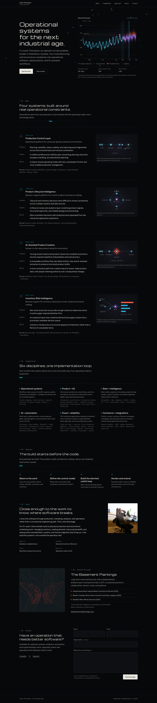

# futuredescriber.com

[](https://github.com/futuredescriber/futuredescriber.com/actions/workflows/ci.yml)

Source code for **[futuredescriber.com](https://www.futuredescriber.com)** — the personal portfolio of Justin Thompson, an operator turned systems builder working across manufacturing, ecommerce, operational software, data pipelines, and human-in-the-loop AI workflows.



## Architecture & Highlights

- **Zero-runtime static Astro build (`output: 'static'`):** No backend server, database, or environment variables required; deploys directly to Netlify with strict HTTP security headers (`X-Frame-Options: DENY`, `X-Content-Type-Options: nosniff`, `Cross-Origin-Opener-Policy: same-origin`, `Permissions-Policy`) and immutable fingerprinted asset caching.
- **Seeded interactive Canvas forecast instrument:** `src/lib/forecast-model.ts` drives both the live Canvas visualization (`src/scripts/forecast.ts`) and a build-time static SVG fallback so the entire site remains usable with JavaScript disabled or `prefers-reduced-motion` enabled.
- **Viewport-gated SVG schematics:** Four animated operational schematics (`src/components/Schematic.astro`) run CSS motion only while visible in the viewport.
- **Automated quality & accessibility gates:** Playwright end-to-end tests (`tests/portfolio.spec.ts`) verify responsive layout across 6 breakpoints (320px–1440px), keyboard traversal, no-JS usability, reduced-motion compliance, axe-core WCAG 2.1 A/AA conformance, and zero leaked secrets or local paths in built output.
- **Static contact form:** Netlify Forms with honeypot protection (`bot-field`) and a custom `/message-received/` confirmation route; notification destination is configured outside source control.

> **Note on optional audio assets:** Optional background audio files (`public/audio/mix/*.mp3`) are intentionally excluded from this public repository. The audio controller (`src/scripts/music.ts`) degrades cleanly when audio files are absent, and audio-specific Playwright checks skip automatically unless local audio chunks are present.

## Local Development

Requires Node 22 (see `.nvmrc`).

```bash
npm ci
npm run dev
```

Run the full verification suite:

```bash
npm run check
npm run build
npm run test:e2e
```

## License

MIT — see [LICENSE](LICENSE).
